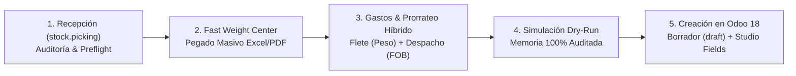

# Odoo 18 - Suite de Operaciones Comerciales & Costeo de Importaciones (Enterprise Edition)

Sistema integral, modular y de alta precisión diseñado para **Mergal SA**, enfocado en dos pilares operativos críticos:
1. **Gestor de Costos en Destino (Landed Costs - `stock.landed.cost`):** Automatización, auditoría previa y prorrateo híbrido exacto ($0.00 USD de margen de error) para recepciones de importación.
2. **Gestor & Sincronizador de Listas de Precios (`product.pricelist`):** Motor ultrarrápido indexado en memoria con tablas hash $O(1)$ para la consulta, modificación y sincronización masiva de tarifas comerciales.

---

## 🌟 1. Módulo de Costos en Destino (Landed Costs)

Diseñado para erradicar las 3 a 5 horas de costeo manual por despacho en hojas de cálculo desconectadas y eliminar el riesgo de distorsión contable en el diario de valoración (`Inventory Valuation`).



### Principales Capacidades de Costeo:
* **Auditoría Previa de Recepción (Preflight Check):**
  * Valida que el albarán (`stock.picking`) esté en estado `done`.
  * Detecta inmediatamente productos con peso cero (`0.00 Kg`) o inconsistencias.
  * Auto-calcula en memoria el **Peso Total Físico** sumando las cantidades y pesos unitarios del albarán.
* **Centro Rápido de Gestión de Pesos (Fast Weight Center):**
  * **1. Pegado Masivo (Excel / PDF):** Admite copiar directamente bloques de dos columnas (`Modelo [TAB] Peso`), textos separados por punto y coma, dos puntos o espacios.
  * **Motor de Emparejamiento Difuso y Normalizado:** Empareja automáticamente con el código (`default_code`) o nombre (`name`) ignorando mayúsculas, guiones y espacios (ej. `WP61PLUS` = `OUKITEL WP61 PLUS (12+512GB)`).
  * **Regla de Desambiguación Inteligente:** Previene que modelos base (ej. `C68`) sobreescriban accidentalmente a versiones avanzadas (ej. `C68 PLUS`).
  * **2. Asignación por Modelo:** Asigna con 1 clic el peso a todas las variantes de color/memoria de un modelo.
  * **Persistencia Directa en Odoo:** Al presionar *Guardar Pesos en Odoo & Revalidar*, los pesos se guardan de forma permanente en la ficha técnica de los productos en Odoo (`product.template` y `product.product`).
* **Prorrateo Híbrido Estandarizado (Regla de Oro #2):**
  * **Flete Internacional:** Se prorratea **Por Peso (`by_weight`)** contra el peso bruto de la guía aérea o marítima.
  * **Despacho Aduanero y Tasas:** Se prorratea **Por Valor FOB (`by_current_cost_price`)**, reflejando la realidad arancelaria aduanera.
  * **Auto-Detección Inteligente:** El sistema detecta por el nombre del producto si corresponde asignarle prorrateo por peso o por valor FOB automáticamente.
* **Simulación Dry-Run en Memoria:**
  * Calcula la absorción de gastos y el costo CIF unitario en USD y Gs sin tocar la base de datos de Odoo.
  * Muestra el FOB unitario tomado directamente de la Orden de Compra (`purchase.order.line`).
* **Creación y Computación en Odoo 18:**
  * Genera el registro `stock.landed.cost` en estado **Borrador (`draft`)** para control previo antes de validar contablemente.
  * Escribe variables personalizadas de Studio (`x_studio_peso_total_de_costeo`, `x_studio_cambio_gastos`, `x_studio_tipo_de_cambio_usd`).
  * Dispara la Acción de Servidor para computar automáticamente los costos unitarios en Gs y USD.
* **Módulo Sanitizer & Auditoría Forense:**
  * Identifica registros antiguos viciados con métodos inválidos (`equal`), pesos en cero o importes desproporcionados.
  * Permite preparar y ejecutar saneamientos controlados con reversión de asientos erróneos.

---

## ⚡ 2. Módulo de Listas de Precios (`product.pricelist`)

* **Motor Hash Indexado en Memoria:**
  * Consultas sub-milisegundo (< 2 ms) sobre el catálogo completo mediante tablas hash $O(1)$ e índices invertidos de tokens.
  * Búsqueda por Código Interno (`default_code`), Código de Barras (`barcode`), ID o nombre.
* **Carga Masiva Multicanal:**
  * Pegar listados completos copiados desde Excel, WhatsApp o correos electrónicos (resuelve cientos de productos al instante).
  * Importación desde archivos Excel/CSV con cruce automático en memoria.
  * Clonación y estirado desde listas de precios ya existentes en Odoo.
* **Ajustes Comerciales Masivos:**
  * Variación porcentual masiva (`+ %` / `- %`).
  * Variación de monto fijo (`+ Monto` / `- Monto`).
  * Redondeo a miles para Guaraníes (`PYG`).
  * Edición individual en celda con cálculo de diferencia en tiempo real.
* **Sincronización Transaccional en Odoo 18:**
  * Creación y actualización de reglas (`product.pricelist.item`).
  * Opción de actualizar en paralelo el precio de venta base (`list_price`).
  * Generación de reportes de auditoría en Excel (`reports/auditoria_precios_*.xlsx`).

---

## 🛡️ 3. Resiliencia & Experiencia de Usuario (Anti-Errores)

* **Tolerancia a Suspensión de Odoo.sh (*Auto-Wakeup & Retry*):**
  * Los entornos Staging de Odoo.sh se suspenden tras inactividad (`Idle`). El conector XML-RPC intercepta este estado, espera 2 segundos mientras el contenedor despierta, se re-autentica de forma transparente y entrega los datos sin arrojar errores 500 al operador.
* **Sanitización de Datos de Entrada:**
  * Conversión automática de comas decimales (`3199,68`) a puntos (`3199.68`).
  * Eliminación de flechas/spinners numéricos en CSS (`::-webkit-inner-spin-button`).
  * Desenfoque automático de inputs al hacer scroll para evitar alteraciones accidentales con la rueda del mouse.

---

## 🏗️ Estructura del Proyecto

```
update_list_price/
│
├── src/                               # Núcleo del microservicio y lógica de negocio
│   ├── __init__.py                    # Inicializador de paquete y versión
│   ├── __main__.py                    # Punto de entrada de ejecución (python -m src)
│   │
│   ├── core/                          # Configuración global y utilidades
│   │   ├── config.py                  # Variables de entorno (.env) y rutas dinámicas
│   │   └── logger.py                  # Logger estructurado con codificación UTF-8
│   │
│   ├── models/                        # Esquemas de datos y validación (Pydantic)
│   │   └── schemas.py                 # Schemas para Preflight, Landed Costs, Sync, etc.
│   │
│   ├── services/                      # Motores de integración y servicios
│   │   ├── odoo_service.py            # Cliente XML-RPC con retry anti-Idle y CRUD
│   │   ├── landed_cost_service.py     # Motor de costeo, preflight, dry-run y sanitizer
│   │   ├── hash_index.py              # Motor en memoria de tablas hash O(1)
│   │   ├── catalog_matcher.py         # Cruce y matching inteligente de productos
│   │   └── file_service.py            # Parser de Excel/CSV y reportes
│   │
│   ├── api/                           # Capa Web REST (FastAPI)
│   │   ├── app.py                     # Instancia FastAPI con renderizador recursivo
│   │   └── routes.py                  # Endpoints REST (/pricelists, /landed-cost/*, etc.)
│   │
│   ├── cli/                           # Interfaz de línea de comandos
│   │   └── console.py                 # CLI interactivo con tablas Rich
│   │
│   └── web/                           # Frontend modularizado (HTML + Tailwind + Alpine.js)
│       └── templates/
│           ├── index.html             # Esqueleto limpio y ligero (53 líneas)
│           ├── components/            # Componentes reutilizables
│           │   ├── header.html        # Barra de navegación y estado de conexión
│           │   └── scripts.html       # Controlador reactivo global Alpine.js
│           └── modules/               # Módulos desacoplados de la interfaz
│               ├── pricelists/        # Sub-app de Listas de Precios
│               │   └── index.html
│               └── landed_costs/      # Sub-app de Costos en Destino
│                   ├── index.html     # Contenedor principal de landed costs
│                   ├── subnav.html    # Pestañas (Costeo, Saneamiento, Historial)
│                   ├── step1_reception.html   # Selección y Fast Weight Center
│                   ├── step2_expenses.html    # Parámetros y líneas de gasto
│                   ├── step3_simulation.html  # Tabla de simulación Dry-Run
│                   ├── tab_sanitizer.html     # Auditoría forense y saneamiento
│                   └── tab_history.html       # Historial de costeos en Odoo
│
├── data_samples/                      # Archivos de ejemplo para pruebas
├── reports/                           # Reportes generados de auditoría
├── main.py                            # Acceso directo al ejecutor
├── run_server.bat                     # Lanzador de Windows (doble clic)
├── requirements.txt                   # Dependencias de Python
├── .env.example                       # Plantilla de variables de entorno
└── README.md                          # Documentación del sistema
```

---

## 🚀 Cómo Iniciar el Sistema

### 1. Requisitos Previos
* Python 3.10 o superior (con entorno virtual `.venv`).
* Acceso a Odoo 18 vía XML-RPC.

### 2. Configurar Variables de Entorno (`.env`)
Crear un archivo `.env` en la raíz del proyecto basado en `.env.example`:
```env
ODOO_URL=https://tu-instancia.odoo.com
ODOO_DB=tu_base_datos
ODOO_USERNAME=usuario_o_email
ODOO_PASSWORD=api_key_o_password
SERVER_HOST=0.0.0.0
SERVER_PORT=8001
```

### 3. Modo Local (Recomendado en Windows)
* **En Windows:** Haz doble clic sobre `run_server.bat`.
* **Desde Terminal / PowerShell:**
  ```powershell
  .\.venv\Scripts\python -m src
  ```
Accede desde tu navegador a: **`http://localhost:8001`**.

### 4. Despliegue en la Nube (Vercel)
El proyecto está pre-configurado para desplegarse como una **Serverless Function de Python** en Vercel con cero configuración adicional:
1. Conecta el repositorio GitHub (`sistema_gestion_odoo18`) en tu panel de Vercel (**Import Project**).
2. En la sección **Environment Variables** de Vercel, agrega de forma segura las credenciales:
   * `ODOO_URL`: URL de tu instancia Odoo (ej. `https://mi-empresa.odoo.com`).
   * `ODOO_DB`: Nombre de la base de datos de Odoo.
   * `ODOO_USERNAME`: Usuario o correo con permisos API.
   * `ODOO_PASSWORD`: Contraseña o API Key de Odoo.
3. Haz clic en **Deploy**. Vercel procesará automáticamente `vercel.json` y `api/index.py`.

---

## 📚 Documentación Operativa y Guías de Referencia

* 📋 **Procedimiento Operativo Estándar (SOP):**  
  [Procedimiento Costeo de Importaciones SOP](procedimiento_costeo_importaciones_sop.md) — *Normas operativas, checklist previo, especificación de formatos de pegado y plantilla certificada de data entry.*
* 📖 **Guía Administrativa de Costeo Odoo 18:**  
  [Guía Costeo Nativo Odoo 18](guia_costeo_nativo_odoo18.md) — *Explicación conceptual de la lógica contable y de prorrateo para gerencia y compras.*
* 🧪 **Protocolo de Validación UAT:**  
  [Protocolo UAT Landed Costs](uat_landed_cost_protocol.md) — *Casos de prueba certificados (Orden 10/11 y Orden 12).*
